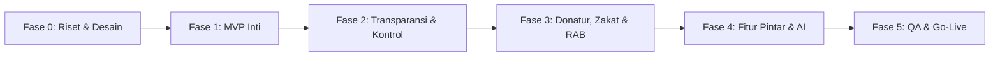
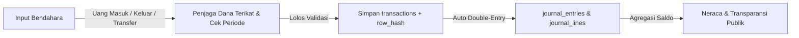

# Masjid Pintar — Sistem Pengelolaan Keuangan Masjid

Aplikasi web pencatatan keuangan masjid yang transparan, akurat, ramah bagi bendahara non-akuntan, dan menghasilkan neraca otomatis yang selalu seimbang.

Dokumen perencanaan lengkap tersedia pada [Planning Project Sistem Pengelolaan Keuangan Masjid ( Masjid Pintar ).pdf](Planning%20Project%20Sistem%20Pengelolaan%20Keuangan%20Masjid%20(%20Masjid%20Pintar%20).pdf).

---

## Daftar Isi

1. [Ringkasan Proyek & Prinsip Utama](#1-ringkasan-proyek--prinsip-utama)
2. [Stakeholder & Matriks Peran (RBAC)](#2-stakeholder--matriks-peran-rbac)
3. [Requirement Sistem](#3-requirement-sistem)
4. [Proses Perangkat Lunak (SDLC)](#4-proses-perangkat-lunak-sdlc)
5. [Design Thinking & Filosofi UI/UX](#5-design-thinking--filosofi-uiux)
6. [Arsitektur & Konsep Akuntansi](#6-arsitektur--konsep-akuntansi)
7. [Struktur Folder Proyek](#7-struktur-folder-proyek)
8. [Struktur Basis Data & ERD](#8-struktur-basis-data--erd)
9. [Daftar Fitur & 14 Sistem Inovasi](#9-daftar-fitur--14-sistem-inovasi)
10. [KPI Analitik & Mitigasi Risiko](#10-kpi-analitik--mitigasi-risiko)
11. [Instalasi Lokal, Konfigurasi & Pengujian](#11-instalasi-lokal-konfigurasi--pengujian)
12. [Roadmap Pengerjaan](#12-roadmap-pengerjaan)

---

## 1. Ringkasan Proyek & Prinsip Utama

**Tujuan:** Menyediakan sistem pencatatan keuangan masjid yang transparan, akurat, mudah dipakai bendahara non-akuntan, dan menghasilkan neraca otomatis secara *real-time*.

1. **Segregasi Dana:** Zakat, infak, wakaf, pembangunan, qurban, dan dana operasional dipisahkan karena aturan penggunaannya berbeda.
2. **Akuntansi di Belakang Layar:** Bendahara cukup mengisi form *Uang Masuk*, *Uang Keluar*, atau *Pindah Kas*; sistem menghasilkan jurnal berpasangan (*double-entry*) otomatis.
3. **Transparansi Publik:** Jamaah dapat melihat ringkasan keuangan dan aliran dana tanpa perlu login.
4. **Jejak Audit Ketat:** Transaksi berstatus `posted` tidak dihapus permanen, hanya dapat dibatalkan melalui mekanisme `void` dengan alasan tercatat dan diamankan dengan `row_hash` (SHA-256 berantai).
5. **Desain Tenang & Jelas:** Antarmuka hangat, minimalis, kontras tinggi, dan mudah dibaca oleh pengurus semua usia.

---

## 2. Stakeholder & Matriks Peran (RBAC)

| Stakeholder / Peran | Tujuan & Kebutuhan Utama | Hak Akses Sistem |
| :--- | :--- | :--- |
| **Admin Sistem** | Menjaga stabilitas aplikasi, master data, pengguna, dan integrasi. | Akses penuh pengaturan, manajemen user/role, backup, dan master COA. |
| **Bendahara** | Mencatat uang masuk/keluar harian dengan cepat tanpa pusing istilah akuntansi. | Input/ubah transaksi, upload nota, ekspor laporan, lihat neraca & kas. |
| **Ketua DKM** | Memantau kesehatan kas masjid dan menyetujui pengeluaran bernilai besar. | Dashboard eksekutif, persetujuan bertingkat, lihat audit log & tutup buku. |
| **Auditor / Pengawas** | Memeriksa kepatuhan syariah, jejak perubahan data, dan integritas saldo. | *Read-only* seluruh transaksi, buku besar, `audit_logs`, dan verifikasi `row_hash`. |
| **Jamaah / Publik** | Memastikan dana infak/sedekah dikelola amanah dan transparan. | Akses tanpa login ke Beranda Transparansi, Laporan Publik, dan Halaman Donasi. |
| **Donatur (Muzakki)** | Mendapat kemudahan berdonasi (QRIS/transfer) dan bukti donasi resmi. | Halaman donasi dan penerimaan bukti donasi otomatis (WhatsApp). |
| **Mustahik** | Menerima penyaluran zakat secara tepat sasaran berdasarkan 8 asnaf. | Tercatat di database `mustahik` dan riwayat `distributions`. |

---

## 3. Requirement Sistem

### A. Kebutuhan Fungsional
- Pencatatan uang masuk, uang keluar, dan transfer antar kas dengan nomor transaksi unik (`TRX-YYYYMM-XXXX`).
- Pembuatan jurnal *double-entry* otomatis (`journal_entries` & `journal_lines`) dalam transaksi database atomik (`DB::transaction`).
- **Penjaga Dana Terikat:** Memblokir penggunaan dana terikat (`restricted`) untuk beban operasional umum (`51xx`).
- Mekanisme pembatalan (`void`) beserta alasan, dan penguncian periode tutup buku (`accounting_periods`).
- Laporan Neraca interaktif (`Aset = Liabilitas + Aset Neto`) dengan *drill-down* ke jurnal.
- Portal transparansi publik tanpa autentikasi.

### B. Kebutuhan Non-Fungsional
- **Aksesibilitas:** Kontras teks minimal WCAG AA (`4,5:1`, target `7:1` untuk angka penting), area sentuh minimum `44 x 44 px`, ukuran font dapat diperbesar hingga `200%`, serta tersedia **Mode Kontras Tinggi** dan **Mode Gelap Hangat**.
- **Performa:** Target skor Google Lighthouse minimal `90`, optimal pada layar HP murah dan koneksi sinyal lambat.
- **Keamanan:** HTTPS, enkripsi password `bcrypt`, autentikasi kustom + 2FA (target fase lanjut), proteksi CSRF, dan *audit trail* anti-manipulasi.

### C. Kebutuhan Lingkungan (Environment)
- **Server / Lokal:** PHP `8.3` – `8.5` (ekstensi `pdo_mysql`, `mbstring`, `openssl`, `tokenizer`, `xml`, `ctype`, `json`), Composer `2.x`, MySQL `8.0+`.
- **Produksi (Rekomendasi):** VPS `1 vCPU / 2 GB RAM`, Nginx + PHP-FPM, MySQL 8, HTTPS (Let's Encrypt), dan backup harian ke cloud storage.

---

## 4. Proses Perangkat Lunak (SDLC)

Pengembangan menggunakan pendekatan **Iterative & Incremental** yang dibagi ke dalam 6 fase (18–21 minggu):



Setiap siklus fitur mengikuti alur kerja:
1. **Perancangan:** Validasi kebutuhan bendahara dan pemetaan ke skema COA/tabel.
2. **Implementasi:** Penulisan migrasi, model, *Service* (`JournalPostingService`), controller, dan antarmuka Blade/CSS token.
3. **Verifikasi Otomatis:** Penulisan *Feature Test* pada PHPUnit (`tests/Feature/`) dengan database SQLite `:memory:`.
4. **Uji Pengguna:** Pengujian keterbacaan dan alur kerja bersama pengurus masjid sebelum rilis produksi.

---

## 5. Design Thinking & Filosofi UI/UX

### Pendekatan Design Thinking
1. **Empathize:** Wawancara bendahara dan 3–5 pengurus/jamaah untuk memahami kendala pencatatan manual dan ketakutan terhadap istilah akuntansi.
2. **Define:** Bendahara non-akuntan membutuhkan input transaksi sesederhana catatan harian, namun DKM dan jamaah membutuhkan laporan neraca yang akurat dan dapat diaudit.
3. **Ideate:** Menyembunyikan kompleksitas *double-entry* di balik form 3 segmen, memadukan prinsip visual dari **Claude AI** (hangat & editorial), **Apple HIG** (*clarity, deference, depth*), dan **Material 3** (token peran & aksesibilitas).
4. **Prototype:** Penyusunan *moodboard*, *Warm Palette*, wireframe *low-fi* (HP & desktop), serta prototipe interaktif di Figma.
5. **Test:** Uji kegunaan dengan 5 pengguna nyata (termasuk pengurus lanjut usia), audit kontras WCAG AA, dan validasi performa.

### Warm Palette & Gaya Abstrak
- **Proporsi Warna 60-30-10:**
  - `60%` Latar: Krem Pasir (`#FAF6F0`), Putih Gading (`#FFFDF9`), Pasir Muda (`#F1E9DD`).
  - `30%` Teks & Struktur: Cokelat Arang (`#2B2118`), Cokelat Abu (`#6B5E52`), Garis Pasir (`#E3D8C8`).
  - `10%` Aksen: Terakota (`#C2613F`), Zaitun Teduh (`#5E6B4A`), Emas Lembut (`#C9A24B`).
- **Mode Gelap Hangat:** Latar `#1F1914`, Surface `#2A231C`, Teks `#F3EBDD`, Primary `#E08A66`.
- **Gaya Abstrak:** Pola geometris Islami (*rub el hizb*) beropasitas `4–8%` di latar hero; otomatis dinonaktifkan saat **Mode Kontras Tinggi** aktif.
- **Mikrocopy Manusiawi:** Menggunakan kalimat hangat seperti *"Catatan tersimpan. Jazakumullah khairan."* dan *"Uang Masuk"* alih-alih jargon teknis.

---

## 6. Arsitektur & Konsep Akuntansi

Neraca nirlaba mengikuti persamaan:

```text
Aset = Liabilitas + Aset Neto
```



- **Aset:** Kas tunai (`1101`), Bank Syariah (`1102`), E-Wallet/QRIS (`1103`), Inventaris (`1201`).
- **Liabilitas:** Titipan Dana Zakat (`2101`), Titipan Dana Qurban (`2102`).
- **Aset Neto:** Aset Neto Tidak Terikat (`3101`), Aset Neto Terikat Wakaf & Pembangunan (`3201`), ditambah surplus/defisit periode berjalan (`Pendapatan - Beban`).

---

## 7. Struktur Folder Proyek

```text
Finance-Masjid/
├── app/
│   ├── Http/Controllers/
│   │   ├── AuthController.php                 # Login & logout pengurus
│   │   ├── BalanceSheetController.php         # Neraca interaktif & drill-down jurnal
│   │   ├── DashboardController.php            # Ringkasan internal & skor kesehatan
│   │   ├── PublicTransparencyController.php   # Beranda, laporan publik & halaman donasi
│   │   └── TransactionController.php          # Daftar, form cepat 3 segmen & void
│   ├── Models/
│   │   ├── Account.php                        # Bagan Akun (COA)
│   │   ├── AccountingPeriod.php               # Periode tutup buku
│   │   ├── CashAccount.php                    # Kas fisik, bank, e-wallet
│   │   ├── Category.php                       # Kategori transaksi ramah pengguna
│   │   ├── Fund.php                           # Jenis dana (umum/terikat)
│   │   ├── JournalEntry.php                   # Header jurnal otomatis
│   │   ├── JournalLine.php                    # Baris debit/kredit
│   │   ├── Transaction.php                    # Transaksi utama + row_hash
│   │   └── User.php                           # Pengguna internal
│   └── Services/
│       └── JournalPostingService.php          # Engine double-entry, guard & neraca
├── database/
│   ├── migrations/
│   │   ├── 0001_01_01_000000_create_users_table.php
│   │   ├── 0001_01_01_000001_create_cache_table.php
│   │   ├── 0001_01_01_000002_create_jobs_table.php
│   │   ├── 2026_11_27_000001_create_masjid_master_tables.php
│   │   ├── 2026_11_27_000002_create_masjid_transaction_tables.php
│   │   └── 2026_11_27_000003_create_masjid_domain_tables.php
│   └── seeders/
│       ├── DatabaseSeeder.php                 # Akun default & pemanggil master seeder
│       └── MasjidMasterSeeder.php             # Seeder 5 dana, 16 COA, 3 kas, 8 kategori
├── public/
│   └── css/
│       └── masjid-pintar.css                  # Design token Warm Palette, dark & high-contrast
├── resources/
│   └── views/
│       ├── layouts/app.blade.php              # Layout utama + navigasi desktop & mobile
│       ├── auth/login.blade.php               # Halaman login pengurus
│       ├── public/
│       │   ├── home.blade.php                 # Beranda transparansi publik
│       │   ├── report.blade.php               # Laporan publik
│       │   └── donate.blade.php               # Halaman donasi & program dana
│       └── internal/
│           ├── dashboard.blade.php            # Dashboard pengurus
│           ├── balance-sheet.blade.php        # Neraca 2 kolom + drill-down jurnal
│           └── transactions/
│               ├── index.blade.php            # Daftar transaksi, filter & void
│               └── create.blade.php           # Form cepat 3 segmen
├── routes/
│   └── web.php                                # Definisi rute publik & internal
├── tests/
│   └── Feature/
│       ├── ExampleTest.php
│       ├── JournalPostingTest.php             # Uji jurnal otomatis, guard & periode
│       └── MasjidPagesTest.php                # Uji akses rute publik & internal
├── .env.example                               # Template konfigurasi environment
└── phpunit.xml                                # Konfigurasi pengujian SQLite :memory:
```

---

## 8. Struktur Basis Data & ERD

### Kelompok Tabel
| Kelompok | Tabel | Fungsi |
| :--- | :--- | :--- |
| **Pengguna** | `users` *(serta `roles`, `permissions` di fase RBAC lanjutan)* | Akun dan hak akses pengurus |
| **Master** | `funds`, `accounts`, `cash_accounts`, `categories`, `settings` | Jenis dana, Bagan Akun (COA), kas/bank, kategori, profil masjid |
| **Transaksi** | `transactions`, `journal_entries`, `journal_lines`, `attachments` | Input bendahara, jurnal debit/kredit otomatis, foto nota |
| **Donatur & Zakat** | `donors`, `donations`, `mustahik`, `distributions` | Data donatur, riwayat donasi, penerima 8 asnaf, penyaluran |
| **Aset & Anggaran** | `fixed_assets`, `budgets`, `budget_items` | Inventaris/penyusutan dan RAB tahunan |
| **Kontrol** | `accounting_periods` *(serta `audit_logs`, `notifications` di fase lanjutan)* | Penguncian periode tutup buku |

### Relasi Utama (ERD)
- `users` `1 : N` `transactions` (pencatat transaksi)
- `funds` `1 : N` `transactions` (sumber/tujuan dana)
- `categories` `1 : N` `transactions` & `1 : N` `budget_items`
- `cash_accounts` `1 : N` `transactions`
- `transactions` `1 : 1` `journal_entries` & `1 : N` `attachments`
- `journal_entries` `1 : N` `journal_lines` (`N : 1` `accounts`)
- `accounting_periods` `1 : N` `journal_entries`
- `donors` `1 : N` `donations` (`1 : 1` `transactions`)
- `mustahik` `1 : N` `distributions` (`1 : 1` `transactions`)

---

## 9. Daftar Fitur & 14 Sistem Inovasi

### Status Implementasi Saat Ini (MVP Fase 1)
- [x] Beranda Transparansi Publik, Laporan Publik, dan Halaman Donasi tanpa login.
- [x] Autentikasi kustom pengurus & Dashboard ringkasan internal.
- [x] Form cepat 3 segmen (*Uang Masuk*, *Uang Keluar*, *Pindah Kas*) + pembatalan `void` ber-alasan.
- [x] Jurnal *double-entry* otomatis, Penjaga Dana Terikat, `row_hash` berantai, dan validasi periode tutup buku.
- [x] Neraca interaktif 2 kolom dengan *drill-down* ke jurnal.
- [x] *Warm Palette*, pola geometris abstrak, Mode Gelap, dan Mode Kontras Tinggi.

### 14 Sistem Inovasi (Rencana Lengkap)
1. **Asisten Tanya-Jawab Keuangan:** Query *read-only* berbahasa alami melalui Claude API.
2. **OCR Nota Pintar:** Ekstraksi tanggal, nominal, dan toko dari foto nota.
3. **Auto-Kategori:** Rekomendasi kategori otomatis dari riwayat transaksi.
4. **Deteksi Anomali:** Menandai nominal tidak wajar/ganda menggunakan *z-score* & IQR.
5. **Penjaga Dana Terikat:** Pemblokiran otomatis pemakaian dana zakat/wakaf untuk beban umum *(sudah aktif)*.
6. **Forecast Kas:** Prediksi saldo 3–6 bulan dengan model musiman Ramadan/Idul Adha.
7. **Skor Kesehatan Keuangan:** Indeks `0–100` dari rasio kas, konsistensi infak, dan ketepatan RAB.
8. **Ledger Anti-Manipulasi:** Hash berantai `row_hash` pada setiap transaksi *(sudah aktif)*.
9. **Dashboard Transparansi Publik:** Visual *"Ke mana infak Anda pergi"*.
10. **Laporan Jumat Otomatis:** Ringkasan mingguan otomatis ke WhatsApp pengurus.
11. **Mode Ramadan / Qurban:** Pemantauan khusus zakat fitrah, paket, dan hewan qurban.
12. **Kalender Hijriah:** Filter laporan berdasarkan bulan Hijriah.
13. **Rekonsiliasi Bank Semi-Otomatis:** Pencocokan mutasi bank (CSV) dengan catatan kas.
14. **PWA / Mode Offline:** Input transaksi saat sinyal lemah dan sinkronisasi otomatis.

---

## 10. KPI Analitik & Mitigasi Risiko

### 9 KPI Dashboard (Data Analyst)
1. Total saldo & likuiditas (bulan kecukupan kas operasional).
2. Rasio pendapatan terhadap beban bulanan.
3. Tren infak Jumat per minggu.
4. Komposisi pendapatan per sumber dan per dana.
5. Top 5 kategori beban terbesar.
6. Persentase realisasi anggaran (RAB).
7. Jumlah donatur aktif & rata-rata donasi.
8. Persentase zakat tersalurkan ke mustahik.
9. Jumlah transaksi tanpa bukti nota.

### Matriks Risiko & Mitigasi
| Risiko | Mitigasi |
| :--- | :--- |
| Bendahara kesulitan memakai sistem | Antarmuka sederhana, sembunyikan istilah akuntansi, pelatihan singkat |
| Data historis berantakan | Saldo awal dan template import Excel |
| Kebocoran atau manipulasi data | RBAC ketat, 2FA, audit log, `row_hash` berantai, backup harian, HTTPS |
| Ketergantungan pada satu orang | Minimal dua admin aktif dan dokumentasi operasional sederhana |
| Biaya API AI / WhatsApp membengkak | Modul bersifat opsional dan dapat dimatikan per fitur di `.env` |
| Desain estetis tapi sulit dibaca | Uji kontras WCAG AA dan uji coba bersama pengurus lanjut usia |

---

## 11. Instalasi Lokal, Konfigurasi & Pengujian

1. **Siapkan environment:**
   ```bash
   cp .env.example .env
   php artisan key:generate
   ```
2. **Atur database MySQL di `.env`** (`DB_DATABASE=finance_masjid`, `DB_USERNAME=root`, `DB_PASSWORD=`) dan pastikan database `finance_masjid` sudah dibuat.
3. **Jalankan migrasi & seeder:**
   ```bash
   php artisan migrate --seed
   ```
4. **Jalankan server lokal:**
   ```bash
   php artisan serve
   ```
   Akses `http://localhost:8000`. Akun pengurus default: `bendahara@masjidpintar.id` / `password`.
5. **Jalankan pengujian otomatis:**
   ```bash
   php artisan test
   ```

---

## 12. Roadmap Pengerjaan

| Fase | Durasi | Fokus Utama |
| :--- | :--- | :--- |
| **0. Persiapan & Desain** | 2–3 Minggu | Wawancara, penyusunan COA, moodboard, wireframe & design system Figma |
| **1. MVP** | 4–5 Minggu | Auth, master data, form transaksi cepat, jurnal otomatis, neraca, ekspor |
| **2. Transparansi & Kontrol** | 3 Minggu | Dashboard lengkap, halaman publik, persetujuan bertingkat, audit log, tutup periode |
| **3. Donatur & Zakat** | 3 Minggu | Donatur, mustahik, penyaluran, bukti WhatsApp otomatis, RAB tahunan |
| **4. Fitur Pintar** | 4 Minggu | Auto-kategori, OCR nota, deteksi anomali, forecast kas, asisten AI, PWA |
| **5. Penyempurnaan** | 2 Minggu | Uji kegunaan, audit QA/Lighthouse, pelatihan pengurus, migrasi data, go-live |
